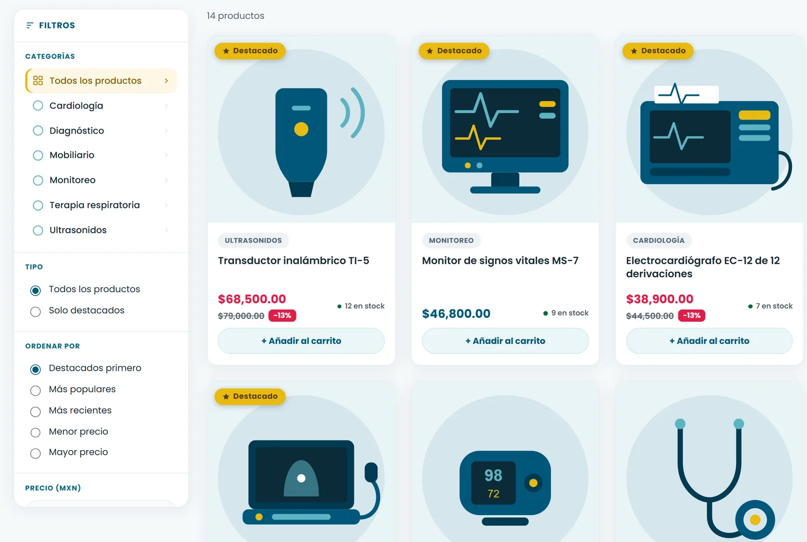
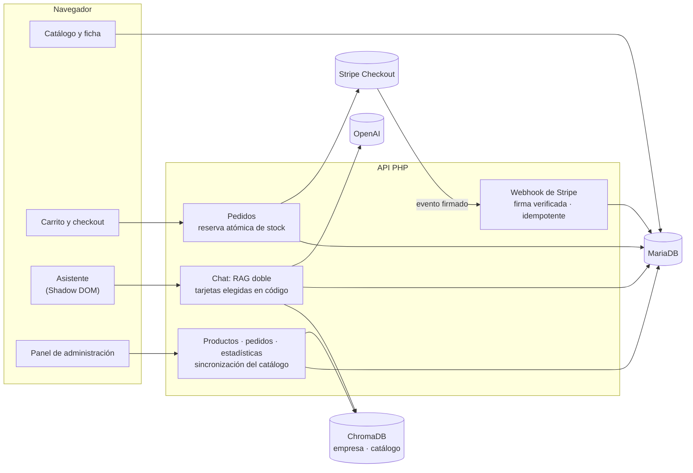
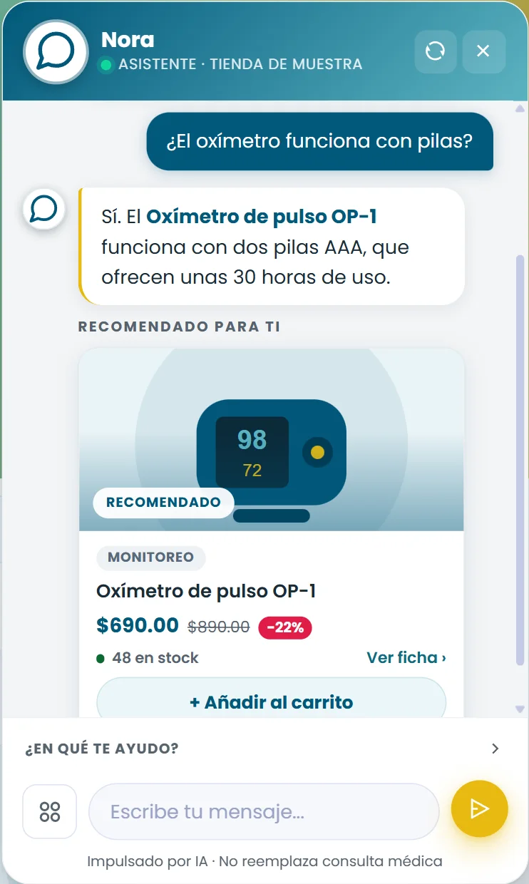
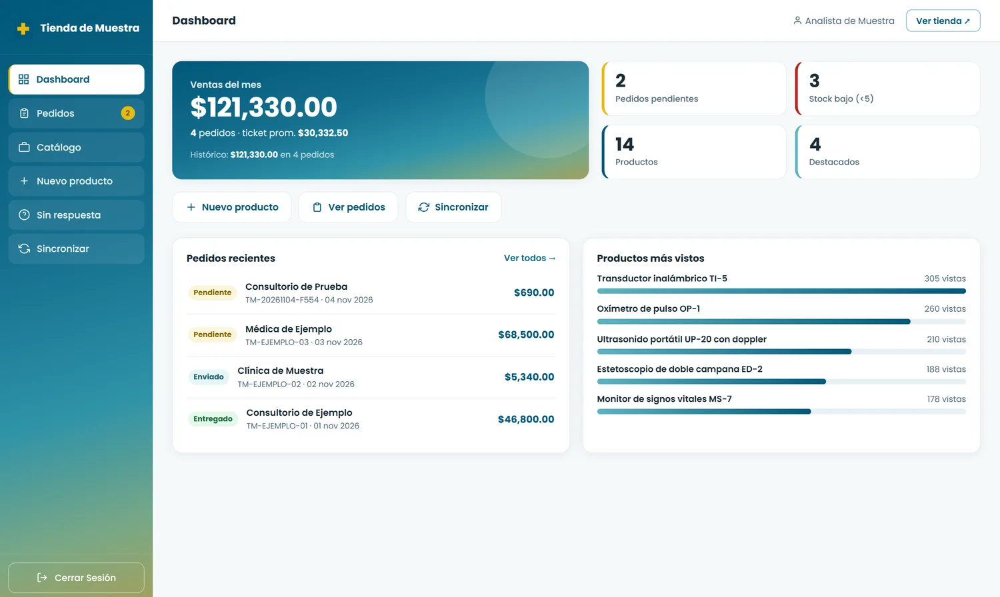

# Caso de estudio: marketplace de equipo médico con asistente de IA que vende

> **Caso de estudio sin el código del cliente.** La tienda es de una plataforma de salud
> cliente de TEDE Consultores, y la desarrollé ahí. Está en producción. Aquí se explican el problema, la
> arquitectura y las decisiones; los fragmentos de [`fragmentos/`](fragmentos/) son
> reescrituras genéricas de mis técnicas, sin nada del cliente, y se pueden ejecutar.



## Resumen

Una tienda de equipo médico con un **asistente de IA que responde y vende**: contesta dudas sobre
la empresa, recomienda productos del catálogo con tarjetas de «añadir al carrito» y permite
**comprar desde el chat**. Pago en línea con Stripe o pedido por WhatsApp, y un panel para
administrar productos, pedidos y lo que el asistente no supo contestar.

## El problema

- Quien compra equipo médico sabe qué necesita resolver («equipar un consultorio de
  cardiología»), pero no qué modelo comprar.
- Un asistente que deja al modelo de lenguaje elegir productos **inventa** productos, precios o
  existencias, y en una tienda eso es inaceptable.
- El hosting es compartido: sin Composer ni SDK de Stripe, y despliegue por FTP.
- Los pagos en línea traen sus propios riesgos: pedidos pagados que no se registran, ventas
  contadas dos veces o inventario retenido por pagos que nunca llegan.

## Arquitectura



Flujo de una pregunta al asistente:

```
mensaje → embedding → ChromaDB (empresa) + ChromaDB (catálogo, con umbral)
        → tarjetas elegidas en código y refrescadas desde la base
        → el modelo redacta la explicación → texto + enlaces + tarjetas
```

## Decisiones técnicas y por qué

**El asistente**

- **RAG sobre dos colecciones:** el conocimiento de la empresa y el catálogo van separados, para
  que una pregunta de producto no traiga solo texto institucional y viceversa.
- **El modelo no elige los productos.** Las tarjetas se calculan **antes** de llamarlo, por
  similitud y con un umbral; el modelo recibe esos mismos productos y solo los explica.
- **La base de datos manda sobre el vector.** La metadata guardada en ChromaDB puede estar vieja
  (precio, existencias, foto); las tarjetas se refrescan desde la base y el vector queda como
  respaldo si la base no responde.
- **Privacidad:** de las conversaciones respondidas solo se guarda un contador; el texto se guarda
  únicamente cuando el asistente **no supo contestar**, que es lo que dice qué falta en el catálogo.

**Los pagos**

- **Stripe sin SDK:** la API REST por cURL; `http_build_query()` produce justo la notación de
  corchetes que Stripe espera. Los importes salen de la base, en centavos, nunca del navegador.
- **El webhook es la única fuente de verdad del pago.** La página de retorno se puede cerrar o
  falsear; el webhook se acepta solo con la firma HMAC válida y un timestamp reciente.
- **Reserva atómica de stock:** `UPDATE … SET stock = stock - ? WHERE id = ? AND stock >= ?`.
  Comprobar primero y restar después deja una ventana en la que dos compras se llevan la misma pieza.
- **Idempotencia:** Stripe reenvía eventos; si el pedido ya está pagado, no se vuelve a sumar la venta.
- **El stock vuelve si el pago no llega:** la sesión de pago caduca y el webhook de expiración
  devuelve lo reservado. Si crear la sesión falla, el pedido se marca como fallido y también se
  devuelve el stock.
- **Consulta del estado con dos llaves:** la página de retorno pide el número de pedido **y** el id
  de sesión de Stripe; con solo el número, que lleva la fecha, se podrían sondear pedidos ajenos.
- **Sin llave de Stripe, la pasarela se apaga sola** y la tienda sigue con pedidos por WhatsApp.

## Retos que resolví

| Reto | Cómo se resolvió |
|---|---|
| El asistente debía recomendar productos sin inventarlos | Tarjetas decididas en código antes del modelo ([fragmento](fragmentos/tarjetas-de-producto.php)) |
| Fotos y precios viejos en las tarjetas del chat | La base manda sobre la metadata del vector |
| Pagos sin SDK en hosting compartido | Cliente REST mínimo y verificación propia de la firma ([fragmento](fragmentos/stripe-sin-sdk.php)) |
| Ventas duplicadas por reintentos del webhook | Guarda de idempotencia por estado del pedido ([fragmento](fragmentos/reserva-de-stock.php)) |
| Inventario retenido por pagos abandonados | Caducidad de la sesión y devolución de stock en el webhook |
| Un demo hecho en Next.js no corría en el hosting del cliente | Lo reescribí en PHP y JavaScript sin frameworks, con el stack del resto de la plataforma |

## Resultados

- **En producción** en el sitio del cliente, con el asistente integrado al catálogo.
- **Pago con tarjeta** (Stripe Checkout) y **«Comprar ahora» desde el chat** en producción desde el
  21 de agosto de 2026.
- El mismo código sirvió de base para una tienda de demostración con la marca de otro prospecto.

## Stack

| Capa | Tecnología |
|---|---|
| Backend | PHP 8 sin framework ni Composer |
| Base de datos | MariaDB por PDO, sentencias preparadas |
| Búsqueda semántica | ChromaDB (API v2) |
| IA | OpenAI `gpt-4o-mini` y `text-embedding-3-small`, por cURL |
| Pagos | Stripe Checkout y webhooks, por su API REST |
| Frontend | HTML, CSS y JavaScript sin frameworks; asistente en Shadow DOM |
| Infraestructura | Hosting compartido Apache / LiteSpeed, despliegue por FTP |

## Fragmentos de código

Reescrituras genéricas, sin datos ni reglas del cliente. Todas se ejecutan solas.

| Archivo | Técnica | Ejecutar |
|---|---|---|
| [`tarjetas-de-producto.php`](fragmentos/tarjetas-de-producto.php) | Tarjetas elegidas en código por umbral y refrescadas desde la base | `php tarjetas-de-producto.php` |
| [`stripe-sin-sdk.php`](fragmentos/stripe-sin-sdk.php) | Sesión de Checkout por REST y verificación de la firma del webhook | `php stripe-sin-sdk.php` (5 comprobaciones) |
| [`reserva-de-stock.php`](fragmentos/reserva-de-stock.php) | Reserva atómica, webhook idempotente y devolución de stock (SQLite en memoria) | `php reserva-de-stock.php` |

## Capturas

Capturas de la demo de [mi portafolio](https://cesar-rodriguez.vercel.app), con un negocio y datos inventados.

| | |
|---|---|
|  |  |

## Mi rol

Proyecto que hice en **TEDE Consultores** para una plataforma de salud, a partir de junio de 2026.

- Llevé un demo de tienda con asistente, hecho originalmente en Next.js, al stack de la plataforma.
- Programé el asistente de compra: RAG doble, tarjetas decididas en código y compra desde el chat.
- Integré los pagos con Stripe sin SDK: Checkout, webhook firmado, reserva y devolución de stock y
  consulta segura del estado del pedido.
- Programé el panel: productos, pedidos, estadísticas, sincronización del catálogo y registro de
  preguntas sin respuesta.
- La desplegué en producción, en el hosting del cliente.

---

## English summary

**Case study: a medical-equipment marketplace with an AI shopping assistant**, built at TEDE
Consultores for a Mexican health platform and running in production. The client's code is
not published; this repository documents the problem, architecture and decisions, with generic,
runnable code samples.

- **Assistant:** RAG over two ChromaDB collections. Product cards are chosen in code by similarity
  and a threshold *before* calling the LLM and refreshed from the database; the model only explains.
- **Payments:** Stripe Checkout through the REST API (no SDK). The signed webhook is the single
  source of truth; stock is reserved atomically, payment events are idempotent and reserved stock is
  returned when a session expires.
- **Stack:** PHP 8 (no framework, no Composer), MariaDB, ChromaDB, OpenAI, Stripe, vanilla JS,
  shared hosting.
